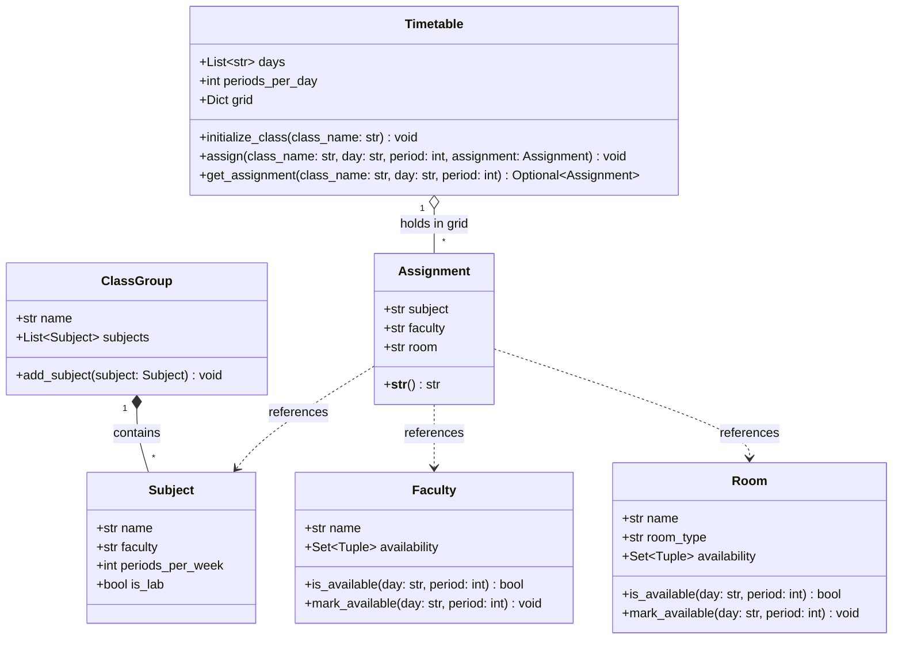

# Conflict-Free Weekly Timetable Generator

A Python-based scheduling utility designed to generate optimal, conflict-free weekly timetables for academic institutions, schools, and organizations using standard library Python only.

---

## 📌 Project Purpose & Problem Statement

Creating a weekly timetable manually is time-consuming and error-prone. Common scheduling challenges include:
- **Teacher/Instructor overlaps**: Multiple classes assigned to the same instructor at the same time.
- **Room/Venue clashes**: Multiple classes competing for the same classroom or lab.
- **Batch/Student conflicts**: The same cohort of students scheduled for two different subjects simultaneously.
- **Resource constraints**: Theory vs. laboratory venue requirements and consecutive multi-period lab blocks.

The purpose of this project is to automate the construction of conflict-free weekly schedules that satisfy all hard constraints, optimize student cohort compactness by minimizing idle gaps, and diagnose infeasible scenarios.

---

## 🧱 Core Data Models & Class Diagram

The core data structures are implemented in [`models.py`](models.py) using Python's standard library `dataclasses`:

- **`Assignment`**: Represents an individual scheduled class session (subject name, faculty identifier, room identifier).
- **`Subject`**: Represents an academic course with weekly period requirements, instructor identifier, and a lab requirement flag (`is_lab`).
- **`ClassGroup`**: Represents a student cohort or section with its enrolled curriculum subjects.
- **`Faculty`**: Represents an instructor with optional availability constraints across `(day, period)` slots.
- **`Room`**: Represents a venue categorized as Theory (`'T'`) or Laboratory (`'L'`) with optional slot availability.
- **`Timetable`**: Encapsulates the 3-dimensional schedule grid (`grid[class_name][day][period] -> Optional[Assignment]`) across configured days and periods per day.

### Mermaid Class Diagram



---

## 📥 Input Specification & Grammar

The input parser ([`parser.py`](parser.py)) processes structured timetable definitions following the format below:

```text
Line 1: days periods_per_day
Line 2: n (number of subject entries)
Next n lines: class_name subject_name faculty_name periods_per_week is_lab
Next line: m (number of rooms)
Next m lines: room_name room_type
```

### Field Definitions:
- **`days`**: Number of active scheduling days (mapped automatically to labels `D1`, `D2`, etc.).
- **`periods_per_day`**: Number of periods/slots per day.
- **`class_name`**: Name/identifier of the student class cohort (e.g., `X`, `Y`).
- **`subject_name`**: Name of the subject (e.g., `TH`, `LAB`).
- **`faculty_name`**: Faculty identifier (e.g., `F1`, `F2`, `F3`).
- **`periods_per_week`**: Total weekly periods required for this subject (> 0).
- **`is_lab`**: Subject venue flag:
  - `0` = Theory subject (1 period per session).
  - `1` = Laboratory subject (scheduled in 2-consecutive-period blocks on the same day).
- **`room_name`**: Venue identifier (e.g., `R1`, `R2`, `L1`).
- **`room_type`**: Venue classification:
  - `'T'` = Theory classroom (only compatible with theory subjects where `is_lab=0`).
  - `'L'` = Laboratory room (only compatible with lab subjects where `is_lab=1`).

### Original Sample Input:
```text
2 3
4
X TH F1 2 0
X LAB F2 2 1
Y TH F1 2 0
Y LAB F3 2 1
3
R1 T
R2 T
L1 L
```

---

## 🛡️ Clash Prevention & Constraint Checking

Implemented in [`validator.py`](validator.py), constraint validation is strictly non-mutating and checks:

1. **Grid Bounds Validity**: Target day and period must lie within the configured timetable dimensions.
2. **Class Slot Exclusivity**: A class cohort cannot be scheduled for more than one subject at the same time.
3. **Room Type Matching**:
   - Theory subjects (`is_lab=False`) require Theory rooms (`room_type='T'`).
   - Lab subjects (`is_lab=True`) require Laboratory rooms (`room_type='L'`).
4. **Room Availability**: Venue must be available in its intrinsic schedule.
5. **Room Clash Prevention**: A room cannot be occupied by multiple classes during the same period.
6. **Faculty Availability**: Instructor must be available during the target slot.
7. **Teacher Clash Prevention**: A teacher cannot instruct multiple classes during the same period (critical for shared faculty across batches, e.g., `F1` teaching both `X` and `Y`).
8. **Consecutive-Period Lab Scheduling**:
   - Two-period lab sessions (`can_place_lab_block`) must be scheduled back-to-back on the same day (`start_period` and `start_period + 1`).
   - Both periods share the same room and instructor.
   - Atomic placement and rollback: if either period encounters a conflict, the entire block is rejected.

### Key Validation Functions:
- `can_place_subject(timetable, class_name, day, period, subject, room, faculty=None) -> (bool, str)`
- `can_place_lab_block(timetable, class_name, day, start_period, subject, room, faculty=None) -> (bool, str)`

---

## 🔍 Backtracking Search & Idle-Gap Optimization

Implemented in [`search.py`](search.py) and integrated into [`scheduler.py`](scheduler.py), the scheduling engine combines Constraint Satisfaction Problem (CSP) search with idle-gap optimization:

### 1. Discrete Scheduling Units (`SchedulingUnit`):
- **Theory**: 1-period atomic units.
- **Laboratory**: 2-consecutive-period atomic units assigned and rolled back together.

### 2. Search Heuristics:
- **Minimum Remaining Values (MRV)**: Dynamically chooses the unscheduled requirement with the fewest valid candidate placements to prune unviable branches immediately ("fail-first" principle).
- **Forward Checking**: After every tentative placement, evaluates all remaining unscheduled units. If any remaining unit has 0 valid candidates left, the active branch is pruned immediately.
- **Reversible Assignments**: Tentative slot placements are safely undone upon backtracking without affecting other branches.

### 3. Idle-Gap Optimization:
- **Gap Metric**: An empty period is counted as an idle gap **only** if it lies strictly between the first and last occupied periods of the same class cohort on the same day.
- **Excluded**: Free periods before the first class or after the last class of the day are not counted as gaps. Gaps across different days are never counted.
- **Optimization Strategy**: While satisfying all hard constraints, the solver tracks the best valid timetable found, seeking to minimize total idle gaps. If 0 gaps is achieved, global optimality is proven.

### 4. Search Outcomes:
- **`OPTIMAL`**: Complete conflict-free timetable found and proven to minimize idle gaps.
- **`FEASIBLE_SEARCH_LIMITED`**: A valid conflict-free timetable was found, but the node budget was reached before completing full gap minimization; the best-known valid timetable is safely preserved.
- **`INFEASIBLE`**: The search space was explored with mathematical proof that no conflict-free timetable can satisfy all hard constraints.
- **`LIMIT_REACHED`**: The search node limit was exhausted before discovering any valid schedule (clearly distinguished from proven infeasibility).

---

## 🚨 Infeasibility Reporting & Diagnosis

When scheduling is mathematically impossible, [`search.py`](search.py) invokes `diagnose_blocking_constraint()` to establish the precise root cause:

- **Missing Venue Type**: A lab subject exists without any laboratory rooms (`room_type='L'`), or a theory subject exists without theory rooms (`room_type='T'`).
- **Insufficient Daily Periods**: A lab subject is required but daily periods is less than 2, preventing 2-consecutive-period block scheduling.
- **Room Capacity Overload**: Total required periods exceeds the aggregate slots provided by compatible venues.
- **Class Slot Capacity Exceeded**: Enrolled periods for a class cohort exceeds the total slots in the week.
- **Faculty Capacity Conflict**: An instructor is assigned more periods across classes than available slots in the week (e.g., shared faculty across batches).
- **General Mutual Conflicts**: When individual capacities are within limits but simultaneous mutual constraints clash, the system explains that the exact cause cannot be isolated automatically and mutual constraint conflict prevents a schedule.

---

## 📄 Timetable Output Deliverable (`timetable_output.txt`)

When generating a schedule (`python main.py --schedule`), the system saves the complete result to `timetable_output.txt`:

- **Terminal Output**: Preserves full interactive console display.
- **Output File Content**:
  - Class names, days, periods, subjects, faculty IDs, and room IDs in a formatted grid.
  - Search status (`OPTIMAL`, `FEASIBLE_SEARCH_LIMITED`, `INFEASIBLE`, or `LIMIT_REACHED`).
  - Scheduled and unscheduled period counts.
  - Idle-gap count.
  - Detailed breakdown per subject.
- **Integrity**: If scheduling fails (infeasible or search budget exhausted), the output file clearly documents the failure, diagnostics, and unscheduled counts, and **never** writes a misleading or partial grid.

---

---

## ⚡ Scalability Benchmark & 10-Class Stress Test

The generator features a deterministic, reproducible scalability benchmark ([`stress_test.py`](stress_test.py)) designed to evaluate scheduling performance under heavy resource contention:

### Benchmark Specification:
- **Class Cohorts**: Exactly 10 student classes (`C1` through `C10`).
- **Subject Entries**: Exactly 40 subject entries (4 per class: 3 `TH` theory entries, 1 `LAB` laboratory entry).
- **Subject Placeholders**: Strict assignment standard placeholders: `TH` for all theory subjects, `LAB` for laboratory subjects.
- **Time Grid**: 5 days × 6 periods = 30 weekly periods per class.
- **Total Workload**: Exactly 300 curriculum periods across all classes (100% capacity utilization).
- **Curriculum per Class**:
  - `TH` (Theory 1): 10 periods/week (`is_lab=0`)
  - `TH` (Theory 2): 10 periods/week (`is_lab=0`)
  - `TH` (Theory 3): 6 periods/week (`is_lab=0`)
  - `LAB` (Laboratory): 4 periods/week (`is_lab=1`, scheduled as 2 blocks of 2 consecutive periods)
- **Resource Pools**:
  - **14 Venues**: 10 Theory classrooms (`R1`–`R10`), 4 Laboratory venues (`L1`–`L4`).
  - **20 Faculty**: Instructors `F1`–`F20` with staggered loads (≤ 20 periods/week), sharing teachers across cohorts (e.g., `F1` for `C1` and `C2`, `F6` for `C2` and `C3`) to thoroughly exercise clash detection.
- **Lab Constraints**: Every class has `LAB` scheduled in two 2-consecutive-period blocks with identical faculty and lab room.

### Benchmark Results & Complete Timing Metrics (3 Consecutive Runs):
Timing measured strictly via `time.perf_counter()` on standard hardware without console output interference during scheduling:

| Run Number | Search Status | Nodes Explored | Idle Gaps | Scheduled Periods | Parsing Time | Scheduling Time | Validation Time | Total End-to-End Time | 5.0s Threshold | Independent Validation |
| :---: | :---: | :---: | :---: | :---: | :---: | :---: | :---: | :---: | :---: | :---: |
| **Run 1** | `OPTIMAL` | 280 nodes | 0 gaps | 300 / 300 (100%) | 0.0002 s | **2.0527 s** | 0.0007 s | **2.0536 s** | Passed ($\le 5.0$s) | 8/8 Passed |
| **Run 2** | `OPTIMAL` | 280 nodes | 0 gaps | 300 / 300 (100%) | 0.0002 s | **2.3584 s** | 0.0009 s | **2.3594 s** | Passed ($\le 5.0$s) | 8/8 Passed |
| **Run 3** | `OPTIMAL` | 280 nodes | 0 gaps | 300 / 300 (100%) | 0.0001 s | **1.9647 s** | 0.0008 s | **1.9656 s** | Passed ($\le 5.0$s) | 8/8 Passed |
| **Average** | `OPTIMAL` | 280 nodes | 0 gaps | 300 / 300 (100%) | 0.0002 s | **2.1253 s** | 0.0008 s | **2.1262 s** | **PASS** | **100% Valid** |

### Independent Hard-Constraint Validation:
Every scheduled slot is independently validated after generation across all 8 hard constraints:
1. `[PASS]` No instructor is assigned to multiple classes at the same period.
2. `[PASS]` No venue is double-booked during the same period.
3. `[PASS]` No student cohort has overlapping class assignments.
4. `[PASS]` Theory subjects are placed exclusively in Theory rooms (`room_type='T'`).
5. `[PASS]` Laboratory subjects are placed exclusively in Laboratory rooms (`room_type='L'`).
6. `[PASS]` Laboratory sessions occupy 2 consecutive periods on the same day with identical faculty and room.
7. `[PASS]` All 300 required weekly periods are scheduled (0 unscheduled periods).
8. `[PASS]` All faculty and room availability restrictions are satisfied.

---

## ⚠️ Current Limitations

- **Student-Centric Gaps**: Idle-gap optimization minimizes student cohort gaps; instructor gap minimization can be incorporated in future enhancements.
- **Combinatorial Budget**: On very large problem instances, the search budget (`max_nodes`) may terminate with `FEASIBLE_SEARCH_LIMITED` without proving global mathematical optimality.

---

## 🛠️ Instructions for Running the Application

### 1. Run the Scalability Stress Test (10 Classes in < 5 Seconds)
```powershell
python main.py --stress-test
```
Runs the 10-class benchmark, measures execution time via `time.perf_counter()`, independently verifies all 8 hard constraints, and writes the complete schedule to `timetable_stress_output.txt`.

You can also run the benchmark module directly:
```powershell
python stress_test.py
```

### 2. Generate Conflict-Free Timetable (Standard / Custom Input)
```powershell
python main.py --schedule
```
Outputs the complete schedule to the terminal and saves it to `timetable_output.txt`.

To specify a custom input file or custom output path:
```powershell
python main.py --schedule input.txt
python main.py --schedule --output my_timetable.txt
```

### 3. Run Test Suites
```powershell
python main.py --test
```
Runs all 40 unit tests (10 Validator tests + 30 Scheduler, Infeasibility, and Deliverable tests).

Individual test suites can also be run directly:
```powershell
python validator.py
python scheduler.py
```

### 4. Parse and Display Input Summary
```powershell
python main.py --sample
```
